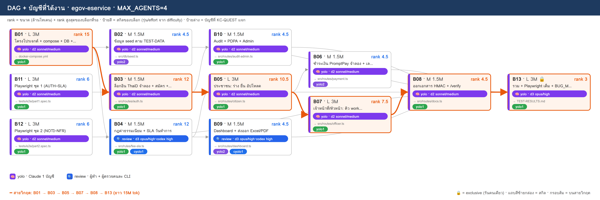
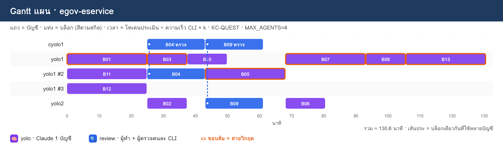

# PLAN · egov-eservice

**โจทย์:** เว็บ e-Service กลางของเทศบาลสมมติ ตาม /workspace/egov-brief (README, REQUIREMENTS, CONTRACT, TEST-DATA, DECISIONS ครบทุกข้อ) Node 22 + TypeScript + Express + EJS + PostgreSQL 16 รันด้วย docker compose คำสั่งเดียว รองรับ TEST_MODE=1 และ BUG_MODE ตาม BUGS.md พร้อมชุด Playwright ครบ 51 TC ใน TEST-PLAN.md

วางแผนเมื่อ 17/11/2026 10:24 · MAX_AGENTS 4 · บัญชี cyolo1, yolo1, yolo2 · ตัวปรับเวลา k (ยังไม่มี calib.json → k=1)

> แผนนี้ยังไม่ได้รันจริง — KC-QUEST เลือกบัญชีจากโควตา แล้วจำลองเวลาตาม dependency

## 1) โควตาของแต่ละบัญชี

| บัญชี | แพลน | ใช้ไป 5 ชม. | ใช้ไปสัปดาห์ | headroom | รีเซ็ต/หมดอายุ (ชม.) | U | slot | ที่มา |
|---|---|---|---|---|---|---|---|---|
| cyolo1 | plus | 0% | 0% | **100%** | 35.4 | 0.404 | 3 | team.py quota |
| yolo1 | default | 7% | 41% | **59%** | 35.6 | 0.403 | 3 | team.py quota |
| yolo2 | default | 6% | 2% | **94%** | 119.6 | 0.167 | 3 | team.py quota |

## 2) DAG + สกิล + บัญชี

**สายวิกฤต:** B01 → B03 → B05 → B07 → B08 → B13 · ยาว 15M tok

## 3) ตารางแจกงาน (เหตุผล KC-QUEST ทุกบล็อก)

| บล็อก | สกิล | ชื่อ | ขนาด · c | รอ | rank | บัญชี (บทบาท) | เริ่ม–จบ (นาที) | เหตุผล KC-QUEST |
|---|---|---|---|---|---|---|---|---|
| **B01** | 🧠 yolo | โครงโปรเจกต์ + compose + DB + test hook | L · 3 | – | 15 | yolo1 (ทำ) | 0.0–25.0 | ทำ: yolo1 44.2 (U=0.403 F=0.017 S=0.852 S=1.0 L=0.0) · 3.00M ≈ 5ชม. 7.8% / สัปดาห์ 0.98% · อันดับ 2 yolo2 34.8 |
| B11 | 🧠 yolo | Playwright ชุด 1 (AUTH–SLA) | L · 3 | – | 6 | yolo1 (ทำ) | 0.0–25.0 | ทำ: yolo1 30.7 (U=0.403 F=0.017 S=0.774 S=0.4 L=0.333) · 3.00M ≈ 5ชม. 7.8% / สัปดาห์ 0.98% · อันดับ 2 yolo2 25.8 |
| B12 | 🧠 yolo | Playwright ชุด 2 (NOTI–NFR) | L · 3 | – | 6 | yolo1 (ทำ) | 0.0–25.0 | ทำ: yolo1 26.2 (U=0.403 F=0.017 S=0.696 S=0.4 L=0.667) · 3.00M ≈ 5ชม. 7.8% / สัปดาห์ 0.98% · อันดับ 2 yolo2 25.8 |
| **B03** | 🧠 yolo | ล็อกอิน ThaiD จำลอง + สมัคร + RBAC | M · 1.5 | B01 | 12 | yolo1 (ทำ) | 25.0–37.5 | ทำ: yolo1 38.2 (U=0.403 F=0.009 S=0.657 S=0.8 L=0.0) · 1.50M ≈ 5ชม. 3.9% / สัปดาห์ 0.49% · อันดับ 2 yolo2 32.3 |
| B04 | 🔍 review | กฎค่าธรรมเนียม + SLA วันทำการ | M · 1.5 | B01 | 12 | yolo1 (ทำ), cyolo1 (ตรวจ) | 25.0–43.1 | ทำ: yolo1 34.2 (U=0.403 F=0.009 S=0.618 S=0.8 L=0.333) · 1.50M ≈ 5ชม. 3.9% / สัปดาห์ 0.49% · อันดับ 2 yolo2 32.3   ตรวจ: cyolo1 39.4 (U=0.404 F=0.001 S=0.988 S=0.56 L=0.0) · 0.45M ≈ 5ชม. 1.17% / สัปดาห์ 0.15% |
| B02 | 🧠 yolo | ข้อมูล seed ตาม TEST-DATA | M · 1.5 | B01 | 4.5 | yolo2 (ทำ) | 25.0–37.5 | ทำ: yolo2 24.8 (U=0.167 F=0.005 S=0.901 S=0.3 L=0.0) · 1.50M ≈ 5ชม. 3.9% / สัปดาห์ 0.49% · อันดับ 2 yolo1 22.8 |
| B10 | 🧠 yolo | Audit + PDPA + Admin | M · 1.5 | B03 | 4.5 | yolo1 (ทำ) | 37.5–50.0 | ทำ: yolo1 26.2 (U=0.403 F=0.009 S=0.579 S=0.3 L=0.333) · 1.50M ≈ 5ชม. 3.9% / สัปดาห์ 0.49% · อันดับ 2 yolo2 24.2 |
| **B05** | 🧠 yolo | ประชาชน: ร่าง ยื่น อัปโหลด | L · 3 | B03, B04 | 10.5 | yolo1 (ทำ) | 43.1–68.1 | ทำ: yolo1 31.2 (U=0.403 F=0.018 S=0.501 S=0.7 L=0.333) · 3.00M ≈ 5ชม. 7.8% / สัปดาห์ 0.98% · อันดับ 2 yolo2 29.7 |
| B09 | 🔍 review | Dashboard + ส่งออก Excel/PDF | M · 1.5 | B04 | 4.5 | yolo2 (ทำ), cyolo1 (ตรวจ) | 43.1–61.2 | ทำ: yolo2 24.2 (U=0.167 F=0.005 S=0.862 S=0.3 L=0.0) · 1.50M ≈ 5ชม. 3.9% / สัปดาห์ 0.49% · อันดับ 2 yolo1 21.1   ตรวจ: cyolo1 34.0 (U=0.404 F=0.001 S=0.977 S=0.21 L=0.0) · 0.45M ≈ 5ชม. 1.17% / สัปดาห์ 0.15% |
| **B07** | 🧠 yolo | เจ้าหน้าที่/หัวหน้า: คิว workflow แจ้งเตือน | L · 3 | B05 | 7.5 | yolo1 (ทำ) | 68.1–93.1 | ทำ: yolo1 30.3 (U=0.403 F=0.018 S=0.423 S=0.5 L=0.0) · 3.00M ≈ 5ชม. 7.8% / สัปดาห์ 0.98% · อันดับ 2 yolo2 26.1 |
| B06 | 🧠 yolo | ชำระเงิน PromptPay จำลอง + เลขคำขอ | M · 1.5 | B05 | 4.5 | yolo2 (ทำ) | 68.1–80.6 | ทำ: yolo2 23.6 (U=0.167 F=0.005 S=0.823 S=0.3 L=0.0) · 1.50M ≈ 5ชม. 3.9% / สัปดาห์ 0.49% · อันดับ 2 yolo1 23.2 |
| **B08** | 🧠 yolo | ออกเอกสาร HMAC + /verify | M · 1.5 | B07 | 4.5 | yolo1 (ทำ) | 93.1–105.6 | ทำ: yolo1 26.6 (U=0.403 F=0.009 S=0.384 S=0.3 L=0.0) · 1.50M ≈ 5ชม. 3.9% / สัปดาห์ 0.49% · อันดับ 2 yolo2 23.0 |
| **B13** | 🧠 yolo | รวม + Playwright เต็ม + BUG_MODE | L · 3 | B02, B06, B08, B09, B10, B11, B12 | 3 | yolo1 (ทำ) | 105.6–130.6 | ทำ: yolo1 24.1 (U=0.403 F=0.019 S=0.306 S=0.2 L=0.0) · 3.00M ≈ 5ชม. 7.8% / สัปดาห์ 0.98% · อันดับ 2 yolo2 21.1 |

## 4) Gantt แผน

## 5) รอบแจกงาน

| นาทีที่ | บล็อกที่เริ่ม |
|---|---|
| 0 | B01→yolo1, B11→yolo1, B12→yolo1 |
| 25 | B03→yolo1, B04→yolo1+cyolo1, B02→yolo2 |
| 37.5 | B10→yolo1 |
| 43.1 | B05→yolo1, B09→yolo2+cyolo1 |
| 68.1 | B07→yolo1, B06→yolo2 |
| 93.1 | B08→yolo1 |
| 105.6 | B13→yolo1 |

## 6) สรุป

- บล็อก 13 · แจกได้ 13 · agent พร้อมกันสูงสุด 4/4
- เวลาประมาณ 130.6 นาที (แท่ง Gantt) · ไฟล์ผลของทีม: `/workspace/plans/egov-eservice/app/`

ต่อไป: `dagplan.py export egov-eservice` → `dagplan.py run egov-eservice` → `dagplan.py report egov-eservice`
