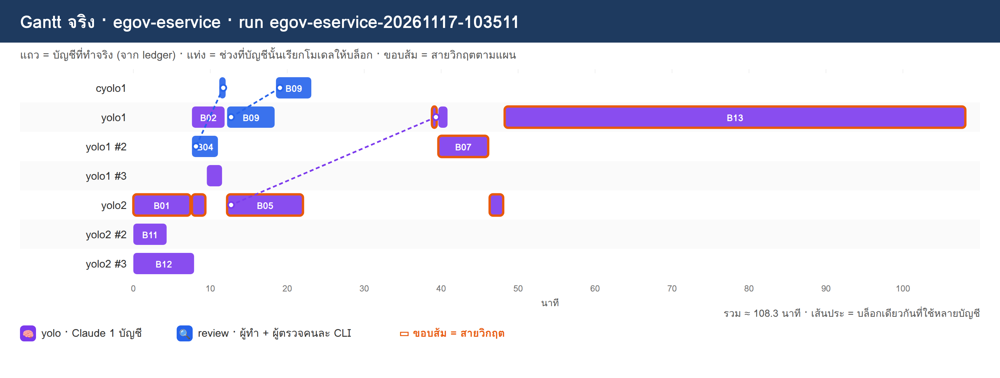
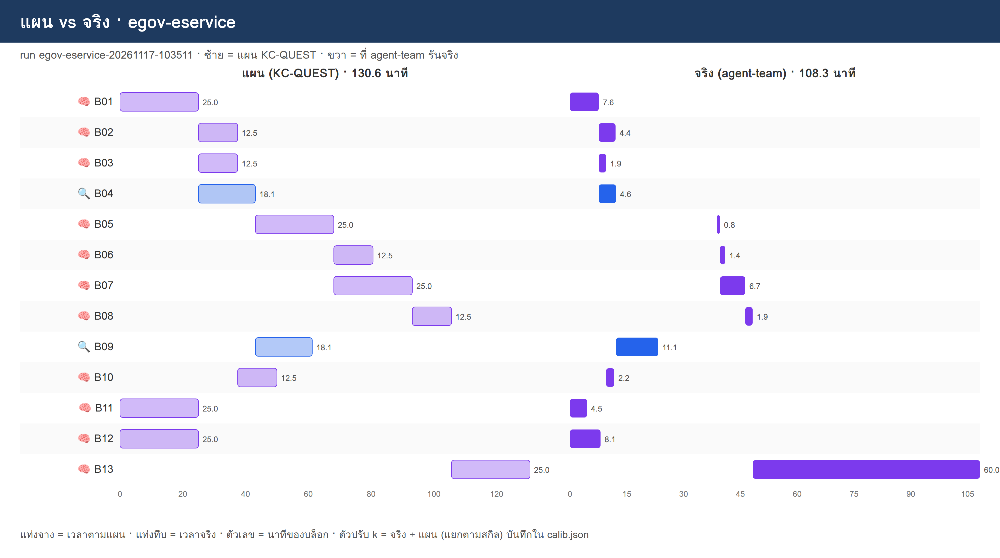

# REPORT · egov-eservice

**run:** `egov-eservice-20261117-103511` · `/workspace/.agent-team/egov-eservice-20261117-103511` · โจทย์: เว็บ e-Service กลางของเทศบาลสมมติ ตาม /workspace/egov-brief (README, REQUIREMENTS, CONTRACT, TEST-DATA, DECISIONS ครบทุกข้อ) Node 22 + TypeScript + Express + EJS + PostgreSQL 16 รันด้วย docker compose คำสั่งเดียว รองรับ TEST_MODE=1 และ BUG_MODE ตาม BUGS.md พร้อมชุด Playwright ครบ 51 TC ใน TEST-PLAN.md

## ตารางบล็อก (แผน vs จริง)

| บล็อก | สกิล | บัญชีแผน | บัญชีจริง | นาทีแผน | นาทีจริง | tokens (ไม่รวม cache read) | ครั้ง | สถานะ | ไฟล์ผล |
|---|---|---|---|---|---|---|---|---|---|
| **B01** | 🧠 yolo | yolo1(ทำ) | yolo2(ทำ) | 25.00 | 7.58 | 121,449 | 1 | ok | ✅ docker-compose.yml |
| B02 | 🧠 yolo | yolo2(ทำ) | yolo1(ทำ) | 12.50 | 4.43 | 83,035 | 1 | ok | ✅ src/db/seed.ts |
| **B03** | 🧠 yolo | yolo1(ทำ) | yolo2(ทำ) | 12.50 | 1.93 | 87,168 | 1 | ok | ✅ src/routes/auth.ts |
| B04 | 🔍 review | yolo1(ทำ), cyolo1(ตรวจ) | yolo1(ทำ), cyolo1(ตรวจ) | 18.13 | 4.57 | 141,278 | 2 | ok | ✅ src/rules/fee-sla.ts |
| **B05** | 🧠 yolo | yolo1(ทำ) | yolo2(ทำ), yolo1(ทำ) | 25.00 | 0.80 | 342,607 | 2 | ok | ✅ src/routes/citizen.ts |
| B06 | 🧠 yolo | yolo2(ทำ) | yolo1(ทำ) | 12.50 | 1.38 | 68,578 | 1 | ok | ✅ src/routes/payment.ts |
| **B07** | 🧠 yolo | yolo1(ทำ) | yolo1(ทำ) | 25.00 | 6.68 | 219,958 | 1 | ok | ✅ src/routes/officer.ts |
| **B08** | 🧠 yolo | yolo1(ทำ) | yolo2(ทำ) | 12.50 | 1.93 | 85,947 | 1 | ok | ✅ src/routes/docs.ts |
| B09 | 🔍 review | yolo2(ทำ), cyolo1(ตรวจ) | yolo1(ทำ), cyolo1(ตรวจ) | 18.12 | 11.13 | 238,306 | 2 | ok | ✅ src/routes/dashboard.ts |
| B10 | 🧠 yolo | yolo1(ทำ) | yolo1(ทำ) | 12.50 | 2.17 | 72,762 | 1 | ok | ✅ src/routes/audit-admin.ts |
| B11 | 🧠 yolo | yolo1(ทำ) | yolo2(ทำ) | 25.00 | 4.50 | 167,289 | 1 | ok | ✅ tests/e2e/part1.spec.ts |
| B12 | 🧠 yolo | yolo1(ทำ) | yolo2(ทำ) | 25.00 | 8.07 | 249,379 | 1 | ok | ✅ tests/e2e/part2.spec.ts |
| **B13** | 🧠 yolo | yolo1(ทำ) | yolo1(ทำ) | 25.00 | 60.03 | 284,372 | 1 | failed — timeout after 3600s | ❌ TEST-RESULTS.md |

- tokens รวมของบล็อก **2,162,128** = ผลรวมจาก ledger ของ run (16 การเรียก) **2,162,128** ✅ ตรงกัน
- การเรียกที่ไม่ใช่บล็อก (ตรวจความพร้อม ฯลฯ): 0 ครั้ง · 0 tokens (ไม่นับในตาราง)
- เวลารวม: แผน 130.6 นาที · จริง 108.3 นาที
- บล็อกเสร็จ 12/13

## ภาพ

## ความต่างระหว่างแผนกับของจริง

- B01: แผน yolo1(ทำ) → จริง yolo2(ทำ)
- B02: แผน yolo2(ทำ) → จริง yolo1(ทำ)
- B03: แผน yolo1(ทำ) → จริง yolo2(ทำ)
- B05: แผน yolo1(ทำ) → จริง yolo2(ทำ), yolo1(ทำ)
- B06: แผน yolo2(ทำ) → จริง yolo1(ทำ)
- B08: แผน yolo1(ทำ) → จริง yolo2(ทำ)
- B09: แผน yolo2(ทำ), cyolo1(ตรวจ) → จริง yolo1(ทำ), cyolo1(ตรวจ)
- B11: แผน yolo1(ทำ) → จริง yolo2(ทำ)
- B12: แผน yolo1(ทำ) → จริง yolo2(ทำ)
- (export ส่งเป็นฝั่ง yolo/cyolo ไม่ผูกบัญชี เพื่อให้ failover ของ agent-team ทำงาน → agent-team เลือกบัญชีในฝั่งเองตามโหลด/โควตา ดู references/run.md)

## ตัวปรับเวลา k (calib.json)

`/workspace/plans/calib.json`: {"yolo": 0.2106, "review": 0.4331}

k = นาทีจริง ÷ นาทีแผน (ก่อนคูณ k) แยกตามสกิล · `plan` ครั้งถัดไปคูณเวลาแต่ละบล็อกด้วย k ของสกิลนั้น

## บันทึกการรัน (เพิ่มด้วยมือ)

- รอบแรก (10:35–10:58): B05 ล้มเพราะ timeout 600 วินาที (ค่าตั้งต้น ไม่ได้กำหนด timeout ใน blocks.json) ทำให้ B06 B07 B08 B13 ถูกบล็อก · ผ่าน 8/13
- แก้ blocks.json: เพิ่ม timeout B05–B08 = 1800 วินาที · B13 = 3600 วินาที · B05 ให้ทำต่อจากไฟล์ที่ค้าง · B13 ให้สร้าง playwright.config.ts
- resume (11:14–12:23) ด้วย team.py run graph.json --resume egov-eservice-20261117-103511 รันเฉพาะ B05 B06 B07 B08 B13 · B05–B08 ผ่าน
- B13 ล้มเพราะ timeout 3600 วินาที · งานทดสอบ 51 TC และ BUG_MODE ทำต่อในขั้น 4–5
